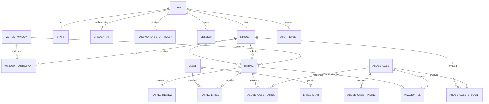

# Data models

Status: Logical PostgreSQL model for the agreed Django backend. No migrations are included. Agreed policies are in [decisions](decisions.md); entity layout and implementation details remain proposals. IDs are opaque internal references. Timestamps are timezone-aware UTC instants.

## Relationships

## User, Student, and Staff

Proposed shared account table: `User(id, role, active, email_verified_at, approved_at, approved_by, created_at)`. Role is `student` or `staff`; verification and approval timestamps start null. `approved_by` is a nullable staff User reference. Automatic approval can leave it null, with an audit record explaining why.

`Student(user_id, intra_username, first_name, last_name, picture_storage_key, campus, imported_at)`: `user_id` is the primary key and User foreign key. `intra_username` is unique and normalized. `first_name` and `last_name` come from the authorized roster. Restrict imported campus to 42 Amman. `picture_storage_key` can be null while image collection is incomplete. Ratings use this internal student key, not the username.

`Staff(user_id, intra_username)`: `user_id` is the primary key and User foreign key, and `intra_username` is unique. Records require trusted provisioning. Setup is not public staff registration. Proposed enforcement: each User has exactly the profile matching its role; no client may choose or change that role. Dual-role accounts remain outside the agreed baseline.

Separate profile tables avoid duplicating usernames across a shared account and its profile. A staff and student username may match; the proposed account-type login selector resolves the trusted profile. Student lookup returns first name, last name, and username; photo display is still proposed.

Email is derived from profile role: student `{intra_username}@student.42amman.com`, staff `{intra_username}@42amman.com`. Do not permit caller-supplied email addresses to redirect setup mail. The local roster and copied pictures must survive loss of 42 API access. See [authentication](authentication.md).

## Credential, PasswordSetupToken, and Session

| Entity | Proposed fields | Constraints |
| --- | --- | --- |
| Credential | `user_id`, `password_hash`, `password_set_at` | One per User; no plaintext passwords |
| PasswordSetupToken | `id`, `user_id`, `token_hash`, `expires_at`, `used_at`, `created_at` | Unique token hash; single use; valid only for an account with no credential |
| Session | `id`, `user_id`, `secret_hash`, `expires_at`, `revoked_at`, `created_at` | Proposed opaque server-side session; unique secret hash |

Token consumption, credential creation, verification, and automatic approval must commit together. Tokens are purpose-bound to setup, not recovery. Never expose token hashes or credentials through profile endpoints. Expiry, password policy, and session implementation remain open.

## SystemSettings

Singleton row: `id`, `manual_student_approval_enabled`, `version`, `updated_by`, `updated_at`. Updates require staff authorization and stale-version checks. Enabling approval never clears existing verification or approval timestamps. Handling already-pending accounts when disabling remains open.

## VotingWindow

Fields: `id`, `name`, `starts_at`, `ends_at`, `min_votes`, `max_votes`, `version`, `roster_captured_at` nullable, `created_by` staff User reference, `created_at`, `updated_at`.

Constraints: `starts_at < ends_at`, `0 <= min_votes <= max_votes`. Proposed interval: inclusive start, exclusive end. Only one active window is agreed; proposed enforcement rejects overlapping date ranges, including edits. State is derived from dates. Lowering a maximum preserves submissions and clamps remaining votes to zero.

## WindowParticipant

Fields: `window_id`, `student_id`, `added_at`. Composite primary key: `(window_id, student_id)`.

Snapshot approved, active, eligible 42 Amman students when the window opens, not at creation. Use a durable opening job or equivalent capture process. Submissions wait for complete capture; concurrent capture attempts must be safe. Ratings reference both voter and recipient membership. If staff change an already-opened window, proposed behavior preserves its snapshot. Mid-window additions remain open; deactivated accounts cannot vote even if in the snapshot.

## Label and LabelStar

`Label(id, name, active, created_by, created_at, retired_at)` retains stable historical wording. Proposed removal: deactivate, never erase historical selections. Proposed renaming: create a replacement record.

`LabelStar(label_id, stars)` has composite primary key `(label_id, stars)` and allows only 1, 2, or 3. Each active label has at least one allowed star. The owner's initial catalog is in [voting rules](voting-rules.md); staff can manage it. `Other` is a configured 1-star flag, not arbitrary label creation by a student.

## Rating and RatingLabel

| Field | Type or constraint | Meaning |
| --- | --- | --- |
| id | Primary key | Vote reference |
| window_id | VotingWindow foreign key | Submission window |
| voter_id, recipient_id | Student foreign keys | Must differ and belong to the window roster |
| stars | Integer 1, 2, or 3 | Selected level |
| explanation | Nullable text | Nonblank and required for 1 star; optional for 2 and 3; staff-only |
| submitted_at | Server timestamp | Time accepted |
| idempotency_key | Text | Retry reference scoped to voter |
| request_fingerprint | Text | Detect reuse with changed content |

Enforce unique `(window_id, voter_id, recipient_id)` across review states and unique `(voter_id, idempotency_key)`. Held and invalidated submissions retain their pair reservation; proposed rejected submissions do too. Contents are immutable under the proposed baseline.

`RatingLabel(rating_id, label_id)` has a composite primary key. Require at least one permitted flag for 1 star, allow empty selections for 3 stars, and provisionally for 2 stars. Validate active catalog membership and star mapping at submission time, not retroactively against historical votes. Exact selection and text length limits remain open.

## RatingReview and derived state

`RatingReview(rating_id, decision, reviewed_by, reason, reviewed_at)`: one review per held 1-star vote under the proposed baseline. Decision is `approve` or `reject`. Reviewer must be staff. Vote-content review is separate from abuse-case review; a serious report is not automatically an abusive vote.

Derived state, in precedence order:

1. Invalidation exists: `invalidated`.
2. 1 star without review: `held`.
3. 1 star with rejection: `rejected`.
4. 1 star with approval: `counted`.
5. 2 or 3 stars: `counted`.

Only counted votes affect averages. Do not store an independently editable counted flag. Lock related records during review or invalidation to prevent inconsistent concurrent decisions. Whether suspicious 2-star or 3-star votes can be held is deferred in D16.

## AbuseCase and evidence

`AbuseCase(id, status, summary, detected_at, reviewed_by, reviewed_at, review_reason, deduplication_key)`: status is `open`, `confirmed`, or `dismissed`; deduplication key is unique. Review fields start null. Summary uses plain language.

`AbuseCaseFinding(id, case_id, mechanism, rule_version, observed_from, observed_to, evidence, explanation)` supports all mechanisms involved in a case. Evidence is structured staff-only data; explanation is readable text.

`AbuseCaseRating(case_id, rating_id)` and `AbuseCaseStudent(case_id, student_id)` have composite primary keys. Attempt-only cases can have no accepted rating but still identify involved students. Proposed `AbuseCaseAttempt(case_id, attempt_id)` links rejected attempts to their evidence. Evidence is suspicion, not proof of intent.

## Invalidation

Fields: `id`, `rating_id` unique, `case_id`, `invalidated_by` staff User reference, `reason`, `created_at`. Require a confirmed abuse case and a rating linked to that case. Preserve the vote; never delete it to negate its effect. Confirmation alone does not invalidate all linked votes. Invalidation does not restore allowance. Repeated invalidation returns the existing decision.

## VoteAttempt and AuditEvent

`VoteAttempt(id, voter_id, recipient_id, window_id, attempted_at, outcome, reason_code, request_reference)`: proposed evidence for authenticated repeated attempts even if duplicate votes are blocked. Recipient and window can be null for unavailable references. Distinguish idempotent retries from deliberate repetition. Never record tokens or full request bodies. Retention remains open.

`AuditEvent(id, actor_id, action, target_type, target_id, occurred_at, change_summary, request_reference)`: actor can be null for documented automated actions. Proposed coverage includes imports, setup completion, approvals, settings, windows, labels, vote reviews, case decisions, invalidation, exports, and trusted role provisioning. Keep audit data staff-only and redact secrets.

## Derived values

| Value | Calculation |
| --- | --- |
| Student average | Sum of counted received stars across all windows divided by counted received rating count; proposed `null` for none and two-decimal display |
| Votes used | All accepted submissions by voter in the selected window, including held and invalidated; proposed including rejected |
| Votes remaining | `max(0, max_votes - votes_used)` |
| Below minimum | `votes_used < min_votes`, for participation reporting only |
| Students who rated | Distinct roster members with at least one accepted submission |
| Students who did not rate | Roster members minus those who rated |
| Rating state totals | Separate submitted, counted, held, rejected, and invalidated totals |

A vote with several labels appears in multiple label groups; those group counts are not additive. Staff window analytics do not change the all-window student average.

## Transactions and indexes

Proposed submission transaction: lock relevant window configuration and voter allowance, verify completed roster capture, membership and current account eligibility, check allowance and pair uniqueness, validate labels and explanation, insert rating and selections, and persist reliable detection work before commit. Define lock order with configuration and catalog edits to avoid stale rules and overspending. Database constraints are the final retry and duplicate guards.

Suggested indexes: normalized student username, first name, and last name for agreed search behavior, ratings by window/voter, window/recipient, recipient/time, window/stars, and submission time; label selections by label; case status/time; attempts by voter/time; held review lookup. Confirm query plans before adding indexes beyond actual needs.
