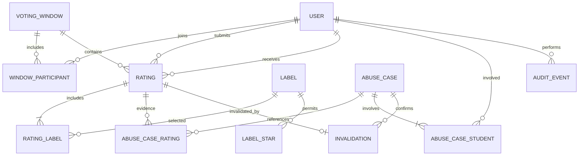

# Proposed data models

Status: Logical model for review, not a migration. All entities and constraints below are proposals. Read [open decisions](decisions.md) before implementation. IDs are opaque server-generated values. Times are timezone-aware instants stored in UTC. Foreign keys preserve referential integrity.

## Relationships

## User

| Field | Type | Meaning |
| --- | --- | --- |
| id | ID, primary key | Internal identifier; never published publicly |
| identity_subject | unique text | Trusted identity-provider reference; never returned to students |
| display_name | text | Approved name for authenticated peer selection |
| role | enum | `student` or `staff` |
| active | boolean | Whether the account can access the application |
| created_at | timestamp | Account creation |

Authentication implementation depends on D02. Do not assume passwords are stored locally. A single role is the proposed baseline; confirm if staff also need student access.

## VotingWindow

| Field | Type | Meaning |
| --- | --- | --- |
| id | ID, primary key | Window reference |
| name | text | Staff-readable title |
| starts_at, ends_at | timestamps | Submission interval |
| min_votes, max_votes | integers | Per-student configuration |
| version | positive integer | Prevents stale configuration updates |
| created_by | User foreign key | Staff creator |
| created_at, updated_at | timestamps | Configuration history pointers |

Constraints: `starts_at < ends_at`, `0 <= min_votes <= max_votes`. Proposed interval is `starts_at <= server_time < ends_at`. Whether overlaps are allowed depends on D11. Active state is derived from dates, not a second status field.

## WindowParticipant

Fields: `window_id`, `student_id`, `added_at`. Composite primary key: `(window_id, student_id)`.

This proposed snapshot defines who counts as a participant, including students with zero ratings submitted. Members must be students. Ratings reference membership for both voter and recipient. Roster changes need an explicit policy under D10.

## Label and LabelStar

`Label`: `id`, `name`, `active`, `created_by`, `created_at`, `retired_at` nullable.

`LabelStar`: `label_id`, `stars`. Composite primary key: `(label_id, stars)`; stars must be 1, 2, or 3.

This supports a label being available for multiple star values without hardcoding names into business logic. Proposed removal is deactivation, preserving existing selections. A name change creates a replacement label. Past selections remain readable even after availability changes. Require at least one allowed star value for an active label.

## Rating

| Field | Type | Meaning |
| --- | --- | --- |
| id | ID, primary key | Vote reference |
| window_id | VotingWindow foreign key | Submission's window |
| voter_id, recipient_id | User foreign keys | Sender and recipient |
| stars | integer | 1, 2, or 3 |
| explanation | nullable text | Only if D14 approves collection; staff-only |
| submitted_at | timestamp | Server-assigned creation time |
| idempotency_key | text | Client-generated retry key, scoped to voter |
| request_fingerprint | text | Detects reuse of a retry key with different contents |

Constraints: valid stars; valid window and participant references; unique `(voter_id, idempotency_key)`. Proposed self-vote rejection and unique `(window_id, voter_id, recipient_id)` depend on D03 and D04. Require the agreed label count and permitted labels at submission time. Do not impose current catalog rules retroactively on historical votes.

Votes are immutable under the proposed baseline. A vote is valid when no Invalidation record exists. Do not keep a second independently editable validity flag.

## RatingLabel

Fields: `rating_id`, `label_id`. Composite primary key: `(rating_id, label_id)`.

Retain label records used by ratings. The historical label text is stable under the replacement policy. Do not cascade label removal into rating history.

## AbuseCase

Fields: `id`, `status` (`open`, `confirmed`, `dismissed`), `summary` (plain language), `detected_at`, `reviewed_by` nullable, `reviewed_at` nullable, `review_reason` nullable, `deduplication_key` unique.

`AbuseCaseFinding`: `id`, `case_id`, `mechanism`, `rule_version`, `observed_from`, `observed_to`, `evidence` (structured staff-only facts), `explanation` (readable text). Multiple findings allow one case to show all detected mechanisms.

`AbuseCaseRating`: `case_id`, `rating_id`; composite primary key.

`AbuseCaseStudent`: `case_id`, `student_id`; composite primary key.

Cases based on rejected attempts may have no linked accepted rating, but must identify involved students. Rule evidence is not proof of malicious intent. Store enough facts for staff to inspect the finding without exposing infrastructure or authentication secrets.

## Invalidation

Fields: `id`, `rating_id` unique, `case_id`, `invalidated_by` (staff User reference), `reason`, `created_at`.

Require a confirmed case and a rating linked to that case. Store the decision instead of deleting the vote. Review and invalidation can be completed in one transaction. A confirmed case does not automatically invalidate every linked vote.

## VoteAttempt

Proposed support for detecting repeated submissions even when D04 blocks duplicate votes. Fields: `id`, `voter_id`, `recipient_id` nullable, `window_id` nullable, `attempted_at`, `outcome`, `reason_code`, `request_reference`.

Record authenticated submission attempts only, using validated references where available. Distinguish deliberate repeat attempts from network retries by the idempotency key. Agree retention before deployment. Never store tokens or full request bodies in this table.

## AuditEvent

Fields: `id`, `actor_id`, `action`, `target_type`, `target_id`, `occurred_at`, `change_summary`, `request_reference`.

Proposed coverage: window changes, catalog changes, case decisions, invalidation, CSV export, and role changes. Keep this staff-only. Redact secrets and unnecessary personal data. Auditing is an engineering proposal, not an explicit PDF requirement.

## Derived values

| Value | Proposed calculation |
| --- | --- |
| Student average | Sum of valid received stars divided by valid received rating count within the agreed scope; `null` for no ratings |
| Votes used | Accepted submissions by voter in the selected window, including invalidated votes if D09 is adopted |
| Votes remaining | `max(0, max_votes - votes_used)` |
| Below minimum | `votes_used < min_votes`; does not prevent submitting the next vote |
| Students who rated | Distinct window participants with at least one accepted submission |
| Students who did not rate | Window participants minus students who rated |
| Valid rating total | Accepted ratings without invalidations in scope |

Expose submitted, valid, and invalidated totals separately to staff so invalidation does not silently change participation definitions. A vote with several labels contributes to several label groups; label-group totals are not additive.

## Transactions and indexes

Proposed submission transaction: load and lock the relevant configuration and voter allowance, check membership and limits, validate labels, insert rating and selections, then commit. Define a consistent lock order with configuration edits so concurrent requests cannot exceed a limit or use stale rules. Database uniqueness is the final guard for retries and pair limits.

Suggested indexes: ratings by `(window_id, voter_id)`, `(window_id, recipient_id)`, `(window_id, stars)`, and `submitted_at`; label selections by `label_id`; cases by status and detection time; attempts by voter and time. Confirm actual indexes against the chosen database and queries.
